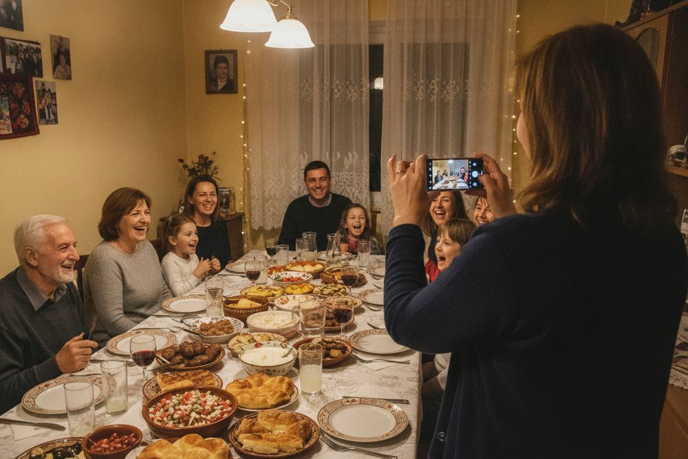
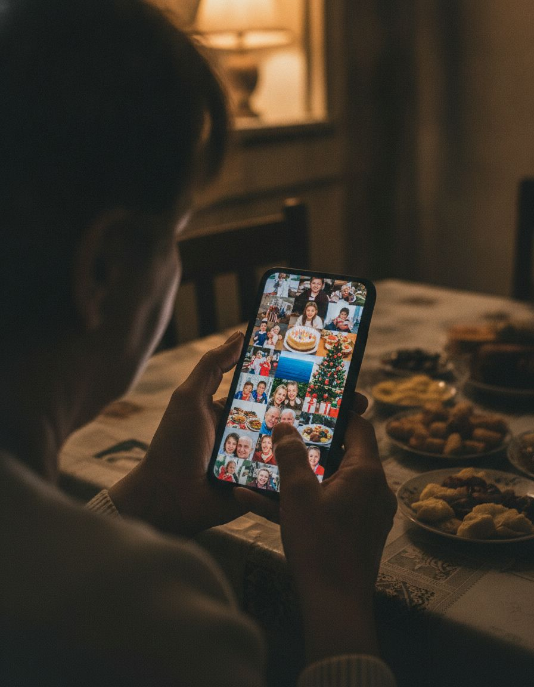
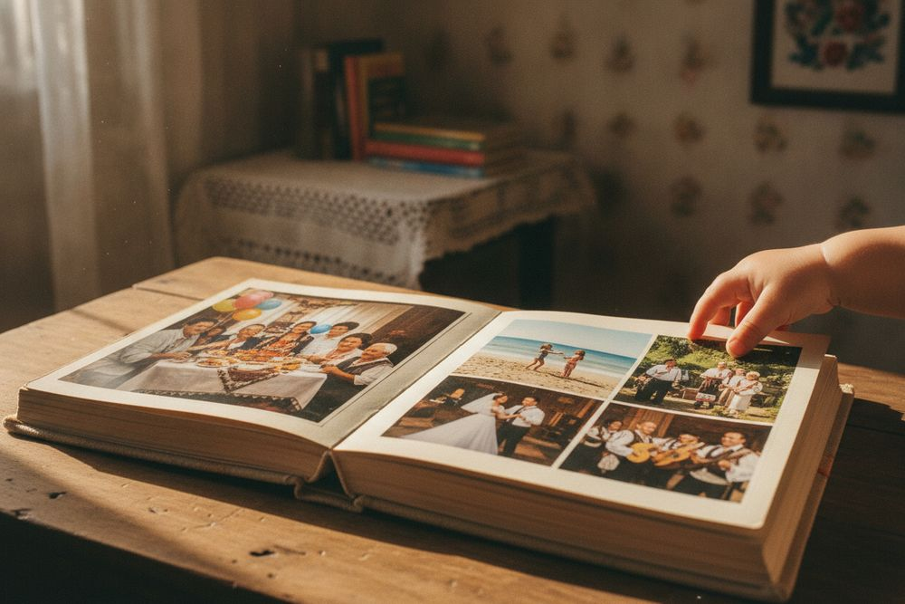
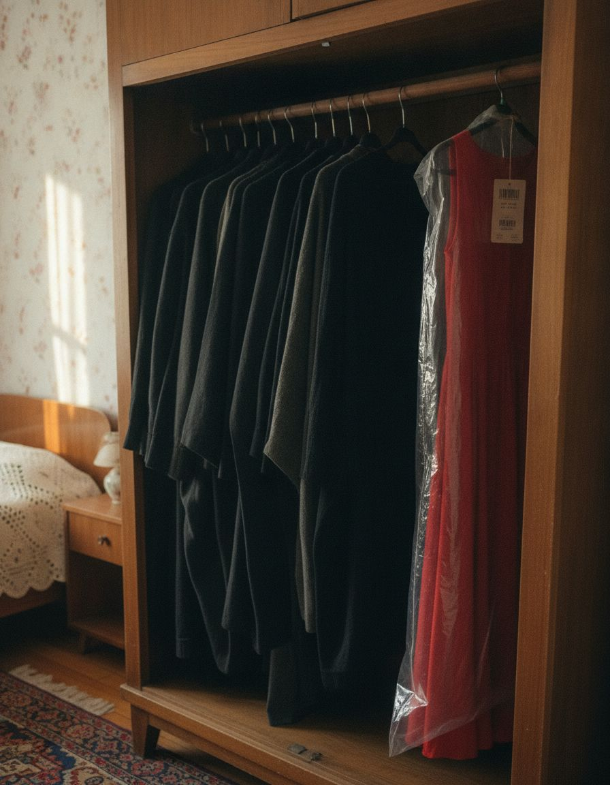
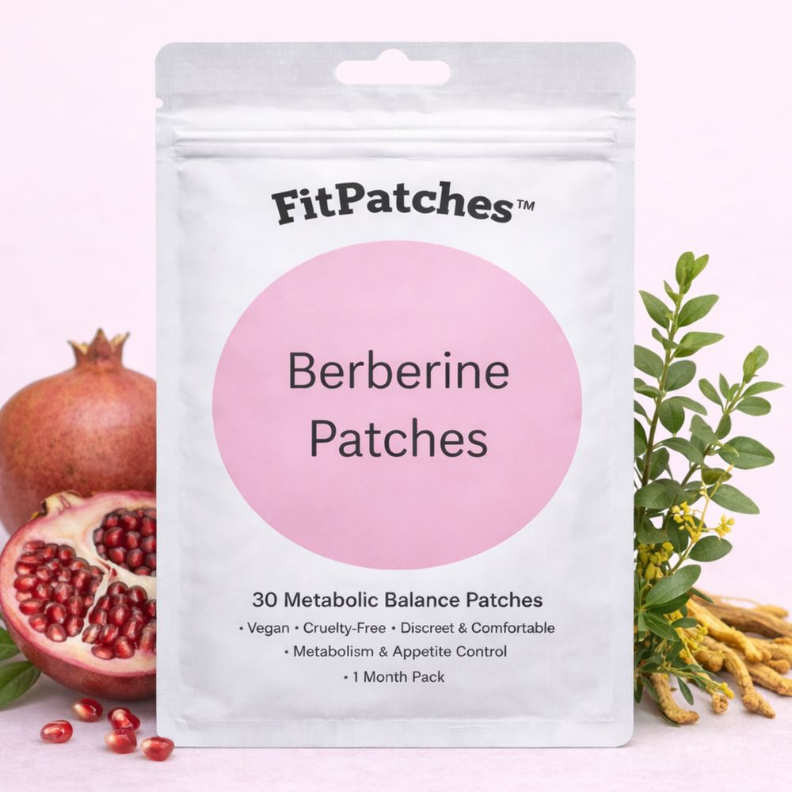
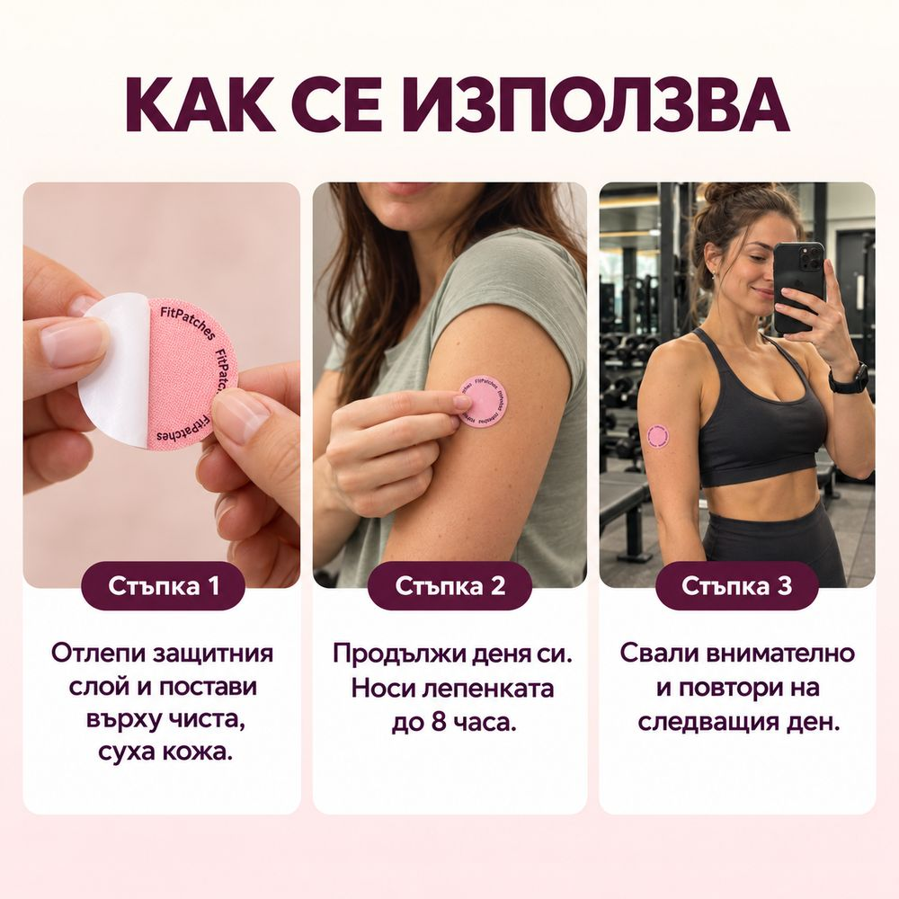
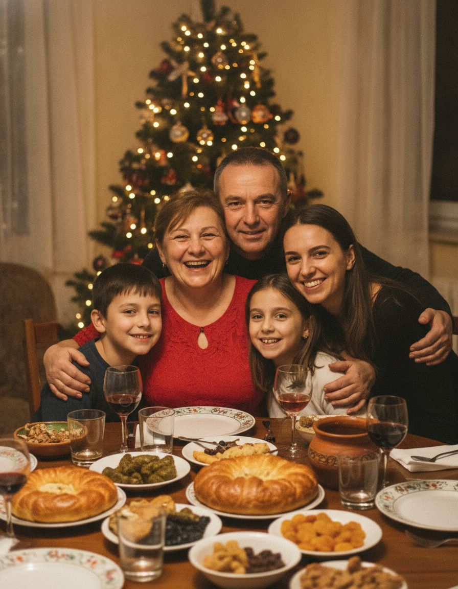

**ПЛАТЕНА ПУБЛИКАЦИЯ · FITPATCHES**

*Жена след 40 · ноември 2026*

# „Аз ще снимам.“ Изречението, с което жените след 40 изчезват от семейните снимки

*Защо диетите от 30-те спират да работят след 40, защо почти никога не е въпрос на воля и един тест с телефона, който отнема две минути.*

Редакцията на FitPatches · **8 минути четене**

*Имен ден. Всички са на снимката. Освен една.*

Масата е готова още от обяд. Баницата е ваша. Салатата е ваша. Сармите, за които всички казват, че никой не ги прави като вас, също са ваши.

И тогава някой вдига чаша: „Хайде една обща, докато сме всички!“

Още преди да е довършил, вие вече сте станали.

## „Аз ще снимам.“

Казвате го леко, с усмивка, сякаш сте най-сръчната с телефона в семейството. Подреждате ги. „Тате, малко наляво. Деца, отпред. Сега всички!“ Щрак. И още една, за всеки случай.

На снимката са всички. Освен вас.

Ако това ви е познато, тази статия е за вас. Тя е за жените над 40, които са опитали поне няколко диети, знаят калориите на почти всичко и въпреки това от години стоят зад телефона, а не пред него.

Ще ви покажем защо се случва, защо почти никога не е въпрос на воля и какво можете да проверите още довечера, с телефона, който държите в ръката си.

## „Не съм фотогенична“

Когато се дръпнем от кадъра, всяка от нас има готово обяснение.

„Не съм фотогенична.“ „Ще се снимам, като сваля няколко килограма.“ „Нека се видят децата.“ „Някой трябва да снима.“

И си вярваме, защото във всяко от тях има по малко истина.

Но ако сме честни, зад всички тях стои едно и също чувство. Не че не харесваме снимките. А че на тях вече не изглеждаме като себе си. Изглеждаме като жена, която се е уморила да опитва.

Най-тежкото обаче не е огледалото. Тежка е мисълта, която идва след поредната диета, приключила по средата: *„Значи е в мен. Другите успяват. Аз просто нямам воля.“*

Ще стигнем до това след малко, защото при повечето жени след 40 тази мисъл е грешна. Първо обаче един кратък тест.

## Тест за две минути: отворете галерията

*Стотици снимки. Колко от тях са с вас?*

Направете го сега, преди да четете нататък.

Отворете галерията на телефона си и превъртете назад до миналия ноември. После бройте само снимките, на които сте вие. Не селфитата, а снимките, които някой друг ви е направил.

Ако и вие сте човекът, който винаги държи телефона, ето какво вероятно ще намерите:

- десетки снимки на децата или внуците;
- торти, маси, морето, елхата, първия сняг;
- снимки на рецепти, които „ще направите някой ден“;
- и себе си, две-три пъти. Отстрани, зад нечие рамо или с наведена глава.

Цифрата не е важна. Важно е какво означава: цяла година от живота ви е заснета, а вас почти я няма в нея.

*Един ден някой ще разлиства тези снимки и ще търси вас.*

След 20 години внуците ви ще разглеждат тези снимки. Няма да гледат талията. Ще търсят баба си. И ще я намерят само на снимките отпреди години.

## Седем начина да излезеш от кадъра, без никой да забележи

Повечето от нас не решават да се крият. Просто малко по малко трупаме навици, всеки с готово обяснение. Вижте колко от тях са и ваши.

1. **„Аз ще снимам.“**
   Обяснението: *„Някой трябва да снима.“*
2. **Заставате най-отзад, на края или зад дете.**
   Обяснението: *„Да се видят малките.“*
3. **Снимате се само от раменете нагоре.**
   Обяснението: *„Така излизам по-добре.“*
4. **Палтото или жилетката остават на вас и на масата.**
   Обяснението: *„Студено ми е.“*
5. **Черното е любимият ви цвят.**
   Обяснението: *„Черното е елегантно.“*
6. **„Само не я качвай никъде.“**
   Обяснението: *„Не обичам социалните мрежи.“*
7. **Има рокля с етикет, която чака в гардероба.**
   Обяснението: *„За някой специален повод.“*

Всеки навик сам по себе си е дреболия. Заедно обаче се превръщат в начин на живот, в който вие сте зад камерата, а животът е пред нея.

*Поводите минават: имени дни, една сватба, три Коледи. Роклята още чака.*

## Какво вече сте опитали (и колко струваше)

Не сте стояли със скръстени ръце. Напротив.

- **Диетата без хляб.** Издържате две седмици. После идва имен ден.
- **Храненето през три часа.** Докато работата и семейството ви позволят.
- **Фитнес картата.** Платена за година, ползвана до Великден.
- **Чайовете „за отслабване“.** Свалят вода, после водата се връща.
- **Хапчетата.** Два-три пъти на ден, с храна. Помните ги до третия ден.
- **Дрехите в два размера.** „За когато сляза малко.“

Пресметнете честно само последните две години. Една фитнес карта в България струва обикновено между 30 и 60 евро на месец. Прибавете хапчетата, чайовете и дрехите, които чакат. Сумата лесно минава няколкостотин евро.

Нищо от това не е било глупаво. Всичко е правено с добро намерение. Има обаче един проблем, който никой не ви е казал: **всичко това е направено за тялото, което сте имали на 30.**

## Не сте се променили вие. Правилата са се променили.

Ето какво не ни казват, докато сме на 30.

**Първо, мускулите.** С годините, ако не ги натоварваме нарочно, те малко по малко намаляват. А мускулите изгарят енергия дори докато седим, спим или гледаме сериал. Когато са по-малко, една и съща чиния „тежи“ повече.

**Второ, хормоните.** Около 40-те започват промените преди менопаузата. Естрогенът постепенно спада и тялото започва да трупа повече около талията, дори когато ядете като преди.

**Трето, сънят.** Става по-лек и се будите в три сутринта. А когато човек не е спал добре, на следващия ден гладът е по-силен. Това не е слабост, просто така работи тялото.

**Четвърто, строгите диети.** За тялото всяка рязка забрана означава, че идва гладно време. И то реагира по най-стария начин, който знае: прави апетита по-силен.

| | На 30 | След 40 |
|---|---|---|
| **Мускули** | Държат се почти сами | Намаляват, ако не ги натоварваме |
| **Сън** | Непробуден | По-лек, будим се нощем |
| **Хормони** | Стабилни | Естрогенът започва да спада |
| **Строга диета** | Сваля бързо | Апетитът става по-силен |
| **Една и съща чиния** | „Тежи“ по-малко | „Тежи“ повече |

Така се завърта кръгът: затягате още, апетитът става още по-силен, издържате по-малко и обвинявате себе си.

> **Не е волята.** Тялото ви вече играе по нови правила, а диетите, които опитвате, още са писани по старите.

## Една майка, която влезе в кадъра

През 2012 г. американската писателка Алисън Тейт публикува кратко есе със заглавие „Мамата остава в кадъра“ (The Mom Stays in the Picture). В него тя признава, че години наред е избягвала снимките, защото не харесва как изглежда. После разбира, че децата ѝ един ден няма да помнят формата ѝ, а дали е била до тях.

Есето обиколи интернет, защото много жени се познаха в него.

Тя е права. Но ние бихме добавили едно: жените след 40 не бягат от кадъра от суета. Бягат от умора. От години опити, които свършват по един и същи начин, и от чувството, че вината е тяхна.

Затова съветът „просто застани на снимката“ е хубав, но не стига. Трябва нещо, което да прекъсне кръга.

## Три неща, които си струва да направите

1. **Застанете в кадъра на следващия празник, преди каквото и да е друго.** Дайте телефона на някой друг и останете на мястото си. Не заради снимката, а за да прекъснете навика.
2. **Върнете малко от това, което годините взимат.** 10–15 минути ходене след най-голямото хранене и половин час по-рано в леглото. Нищо героично, просто всеки ден.
3. **Укротете апетита, без да разчитате на волята си всеки час.** Тук идва това, заради което ви пишем.

## Кой ви пише това

> **ГП** · Казвам се Георги Петков и управлявам FitPatches, българска марка за лепенки с берберин. Държахме първо да разберете причината и чак после да ви покажем какво правим. Ако новите правила след 40 вече ви звучат логично, следващото ще ви е полезно.

## Какво е FitPatches

*Истинският плик: бял, матов, с розов кръг „Berberine Patches“.*

FitPatches е кръгла розова лепенка, голяма колкото монета. Слагате я сутрин на ръката и не мислите за нея до 8 часа.

В нея има **берберин и още пет съставки**: канела, нар, хром, L-глутамин и витамини от група B. Всичките са изписани на плика.

Берберинът е растително вещество, което се съдържа например в корена на кисел трън, и е изследван от години. Изследване при хора за берберин в лепенка обаче не познаваме. Затова ви казваме какво пишат клиентките ни. А те най-често пишат едно и също: **апетитът е по-спокоен.**

| **1 лепенка** | **до 8 часа** | **6 съставки** | **30 броя** |
|---|---|---|---|
| веднъж сутрин | носене през деня | всичките изписани | в плика, точно за месец |

## Защо лепенка, а не още едно хапче

Берберинът се продава и в хапчета. Те обаче се пият два-три пъти на ден, с храна, всеки ден. Точно тук повечето от нас се отказват, не заради продукта, а заради живота.

| | Берберин в хапче | FitPatches |
|---|---|---|
| **Колко пъти на ден** | 2–3 пъти, с храна | Веднъж, сутрин |
| **Нещо за гълтане** | Да | Не |
| **Минава през стомаха** | Да | Не |
| **Съставки** | Берберин | Берберин + още 5 |
| **Лесно ли се помни** | До третия ден | Заедно със сутрешното кафе |

Най-добрият продукт е този, който ще ползвате и на 40-ия ден. А лепенката, която слагате веднъж сутрин, е най-лесното нещо, което можете да превърнете в навик.

### [👉 Вижте FitPatches и наличността](https://fitpatches.net/products/fitpatches-berberinovi-plastiri-30)
*Плащате на куриера при доставка*

## Как да познаете истинските лепенки

Знаем, че първият въпрос е: „Ами ако ми пратят обикновени пластири?“ Ето как изглеждат истинските:

- Кръгли, пепеляво-розови, около 3,5–4 см, колкото монета.
- По ръба имат малък надпис „Fit Patches“.
- Пликът е бял, матов, с розов кръг „Berberine Patches“ и надпис „30 Metabolic Balance Patches“.

И най-важното: **не плащате нищо предварително.** Плащате на куриера, когато пратката е в ръцете ви.

## Как се ползва

*Сутрин, върху чиста и суха кожа. Свалете я след до 8 часа.*

1. Сутрин махнете защитното фолио и залепете лепенката върху чиста, суха кожа без косми: външната страна на ръката, китката, корема или бедрото.
2. Носете я до 8 часа. Под ръкава не се вижда.
3. Свалете я. На следващата сутрин сложете нова, на друго място.

## Какво описват клиентките

Всяко тяло е различно, затова говорим за това, което жените усещат, а не за числа и дати. Най-често ни пишат за:

- **по-спокоен апетит** (това е най-честото);
- **по-малко подуване;**
- **дрехи, които стоят по-добре.**

Лепенката помага, но не замества нормалното хранене и малко движение. Резултатите са индивидуални.

<!--
  МЯСТО ЗА ИСТИНСКИ ОТЗИВИ
  Сложете тук само реални скрийншоти от съобщения на клиентки, с тяхно разрешение,
  без промени в текста. Ако клиентката е получила продукта безплатно, напишете го под скрийншота.
  Без измислени имена, коментари или брой отзиви. Ако нямате такива, оставете секцията изтрита.
-->

*Коледа. Този път в средата.*

А един ден, на някой имен ден или на Коледа, някой ще каже: „Хайде една обща!“

И вие няма да станете. Ще подадете телефона на зет си и ще останете на мястото си, в средата, с червената рокля без етикет.

Това е цялата цел. Не числото на кантара, а снимката, на която сте вие.

## Направете проверката довечера

**4 въпроса, 5 минути**

1. **Галерията.** На колко снимки от последните 12 месеца сте вие, без селфитата?
2. **Последната обща снимка.** Къде стоите? В средата, на края или зад някого?
3. **Гардеробът.** Колко неща чакат „когато сляза малко“?
4. **Последната снимка, на която не сте се приготвили.** Помолихте ли да я изтрият?

Ако се разпознахте в поне два от тях, не сте сама и не е въпрос на воля. Следващата стъпка е проста: започнете утре сутрин.

Ако пиете лекарства, имате хронично заболяване, бременна сте или кърмите, първо говорете с лекаря си.

## Колко струва в сравнение с досегашното

Сложете до сметката от фитнес картата, чайовете и хапчетата това:

| Пакет | Какво получавате | Цена | На ден |
|---|---|---|---|
| [**1 пакет**](https://fitpatches.net/products/fitpatches-berberinovi-plastiri-30) | 30 лепенки · 1 месец | ~~29,99 €~~ **14,99 €** | 0,50 € |
| [**2 + 1 подарък**](https://fitpatches.net/products/fitpatches-2-1-%D0%BF%D0%BE%D0%B4%D0%B0%D1%80%D1%8A%D0%BA-%D0%B1%D0%B5%D1%80%D0%B1%D0%B5%D1%80%D0%B8%D0%BD%D0%BE%D0%B2%D0%B8-%D0%BF%D0%BB%D0%B0%D1%81%D1%82%D0%B8%D1%80%D0%B8) | 90 лепенки · 3 месеца | **27,99 €** | 0,31 € |
| [**3 + 2 подарък** · най-изгодно](https://fitpatches.net/products/fitpatches-5-5-%D0%BF%D1%80%D0%B5%D0%BC%D0%B8%D1%83%D0%BC-%D0%BF%D0%B0%D0%BA%D0%B5%D1%82-%D0%B1%D0%B5%D1%80%D0%B1%D0%B5%D1%80%D0%B8%D0%BD%D0%BE%D0%B2%D0%B8-%D0%BF%D0%BB%D0%B0%D1%81%D1%82%D0%B8%D1%80%D0%B8) | 150 лепенки · 5 месеца, до пролетта | **39,99 €** | под 0,30 € |

✓ Наложен платеж · ✓ Доставка за 1–3 работни дни · ✓ Нищо предварително

Защо пакети? Защото тялото не се променя за седмица. Пакетите са, за да не спрете точно когато започнете да усещате разлика. Под 0,30 € на ден е горе-долу колкото едно кафе седмично.

### [👉 Вижте пакетите](https://fitpatches.net/products/fitpatches-5-5-%D0%BF%D1%80%D0%B5%D0%BC%D0%B8%D1%83%D0%BC-%D0%BF%D0%B0%D0%BA%D0%B5%D1%82-%D0%B1%D0%B5%D1%80%D0%B1%D0%B5%D1%80%D0%B8%D0%BD%D0%BE%D0%B2%D0%B8-%D0%BF%D0%BB%D0%B0%D1%81%D1%82%D0%B8%D1%80%D0%B8)
*Плащате, когато пратката е в ръцете ви*

## Въпросите, които всички задават

<b>Това не е ли поредната измама?</b>

Разбираме въпроса, и ние щяхме да го зададем. Затова не плащате нищо предварително. Плащате на куриера при доставка. Вижте по-горе и как изглеждат истинските лепенки.

<b>Действа ли само там, където е залепена?</b>

Не. Затова се слага на ръката, а не на корема. Лепенката не е замислена за едно място, а за целия организъм.

<b>Мога ли да я ползвам, ако пия лекарства?</b>

Попитайте първо лекаря си. Берберинът може да взаимодейства с някои лекарства, затова това е разговор за него, не за нас.

<b>Кога ще усетя нещо?</b>

При всяка жена е различно. Най-често клиентките първо описват по-спокоен апетит. Дайте си поне един пакет, тоест месец, всяка сутрин.

<b>Вижда ли се?</b>

Колкото монета е и под ръкава не се вижда. Ако я сложите на китката, ще изглежда като малко розово кръгче.

<b>Ами кожата?</b>

Слагайте я върху чиста и суха кожа и сменяйте мястото всеки ден. Ако кожата се зачерви, махнете лепенката.

<b>Трябва ли да спра да ям?</b>

Не. Яжте нормално и балансирано. Лепенката не е диета и не иска да гладувате.

<b>Кой не бива да я ползва?</b>

Бременни, кърмещи и хора под 18 години. При хронично заболяване или лекарства първо питайте лекар.

## Коледа ще дойде така или иначе

**Ако всичко остане същото:** на Коледа пак ще станете първа: „Аз ще снимам.“ Галерията ще се напълни с още стотина снимки и пак две-три с вас. Нищо няма да се влоши точно този месец и точно затова е толкова лесно да отложите.

**Ако започнете утре:** една лепенка сутрин, малко повече сън и ходене, и едно решение: на следващата обща снимка оставате в кадъра.

### [👉 Проверете наличността](https://fitpatches.net/products/fitpatches-berberinovi-plastiri-30)
*Доставка за 1–3 работни дни · наложен платеж*

## Какво да направите сега

1. Отворете страницата на FitPatches.
2. Изберете пакет. За проба стига 1 пакет, тоест месец. Ако искате да ви стигне до пролетта, вземете 3 + 2.
3. Оставете име, адрес и телефон.
4. Куриерът идва до 1–3 работни дни. Плащате при получаване.
5. На следващата сутрин сложете първата лепенка.

### [👉 Отворете страницата на FitPatches](https://fitpatches.net/products/fitpatches-berberinovi-plastiri-30)

**P.S.** Направете теста с галерията довечера. Само бройте, без да се съдите.

**P.P.S.** А червената рокля в гардероба, махнете ѝ етикета още сега. Ще ви трябва за снимката.

---

<small>

Платена публикация на FitPatches. Материалът е с информативен характер и не замества консултация с лекар.

FitPatches не е лекарство и не лекува заболявания. Резултатите са индивидуални. Не е подходящ за бременни, кърмещи и лица под 18 години. При хронично заболяване или прием на лекарства се консултирайте с лекар.

Снимките на хора в тази публикация са илюстративни и са създадени с изкуствен интелект. Снимките на продукта са реални.

</small>
