**ТЯЛО·ДНЕС** · 9 НОЕМВРИ 2026 Г.

# Лекар предупреждава жените над 40: Ако се задъхвате по стълбите, причината може да не е в годините, а в невидима мазнина, която натиска диафрагмата ви — и вдига риска от сърдечни болести и диабет.

 **От д-р Георги Марков** · Метаболизъм · Висцерална мазнина · 8 мин четене

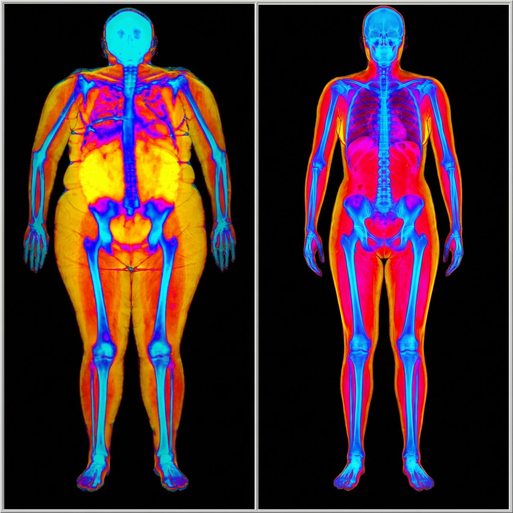

На път съм да ядосам всеки, който ви продава шейкове, „детокс“ чайове, хапчета за отслабване и годишни карти за фитнес.

Защото това, което ще ви кажа, им разваля най-удобната история.

Историята, че вината е във вас. Във вашите навици.

Но първо — нека ви попитам нещо.

Случва ли ви се **да спрете на площадката между втория и третия етаж... уж да си оправите торбите... а всъщност да си поемете въздух?**

Да усещате как **сърцето ви блъска в ушите... лицето ви пламва...** и се молите съседката да не излезе точно сега, за **да не ви види така?**

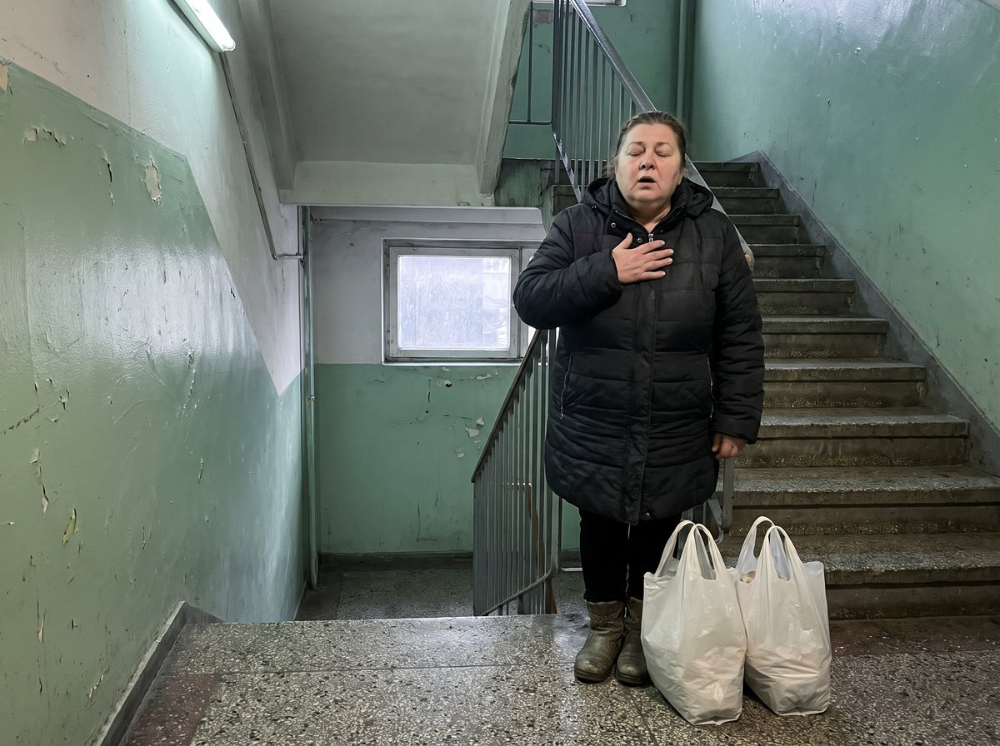

И после да се приберете, да оставите торбите на пода и да седнете за минута. **Сякаш сте тичали маратон. А сте изкачили три етажа.**

**И най-обидното е, че правите „всичко както трябва“.** Пиете витамини. Пиете магнезий. Пиете ябълков оцет на гладно, защото някой каза, че помагал. Пили сте и чай за отслабване, и капсули, и шейк вместо вечеря.

**А стълбите стават все по-дълги.**

Ако се разпознавате дори в половината от това... следващите 7 минути могат да ви спестят години в грешна посока.

Защото ще ви кажа нещо, което рядко ще чуете на глас — нито от рекламите за отслабване, нито на опашката в аптеката.

## ТРЕТИЯТ ЕТАЖ, КОЙТО НИКОЙ НЕ ВЗИМА НАСЕРИОЗНО

Задъхването по стълбите е от онези неща, които всички отписват с махване на ръка.

**„Възрастта е.“ „Кондиция ти трябва.“ „Раздвижи се малко.“ „Нормално е след 45.“**

И вие си повтаряте същото. Записвате се на фитнес. Ходите три пъти. Купувате крачкомер. Сваляте приложение. Купувате поредното шише от аптеката, защото на етикета пише „метаболизъм“.

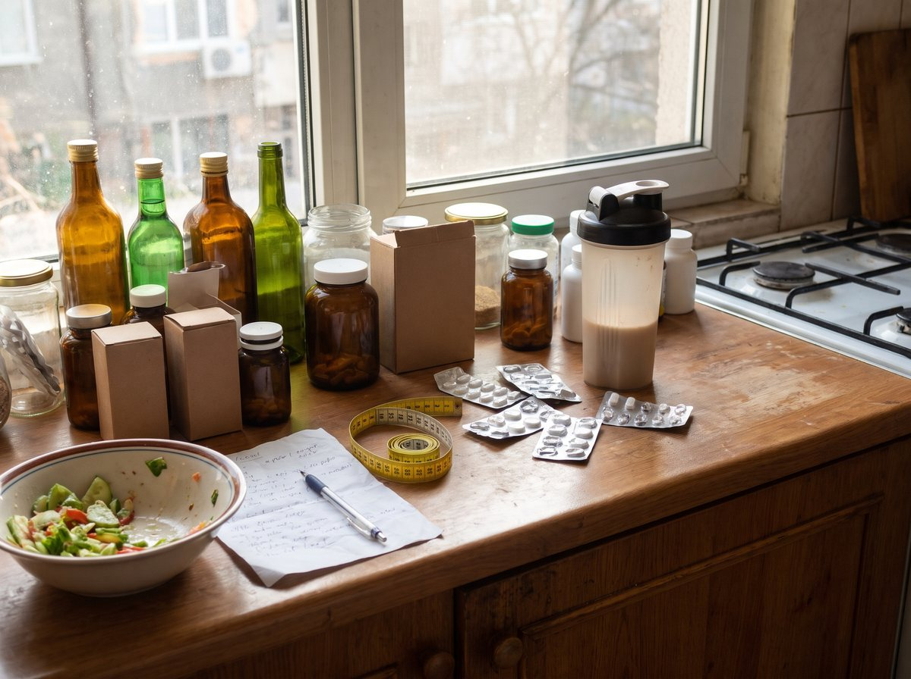

Погледнете шкафа си в кухнята. **Колко шишета има там? Колко от тях свършихте до края?**

**И колко от тях промениха нещо на стълбите?**

**Не е ваша вина.** Защото през цялото време сте гледали на грешното място.

## ИСТИНСКАТА ПРИЧИНА СЕ КРИЕ ТАМ, КЪДЕТО ОГЛЕДАЛОТО НЕ СТИГА

Ето какво не ви казват:

**Задъхването след два етажа често не е въпрос на кондиция. То идва ОТВЪТРЕ... от мазнина, която не виждате в огледалото.**

Казва се висцерална мазнина. Това не е мекото коремче, което хващате с два пръста. Тя е по-навътре — **обвива черния дроб, стомаха и червата като дебело одеяло**.

Представете си гърдите си като кутия, а белите дробове — като балон в нея. Дъното на кутията е диафрагмата — мускулът, който слиза надолу всеки път, когато вдишвате, за да направи място на въздуха.

Сега си представете, че някой е натъпкал под дъното на кутията торба с мазнина.

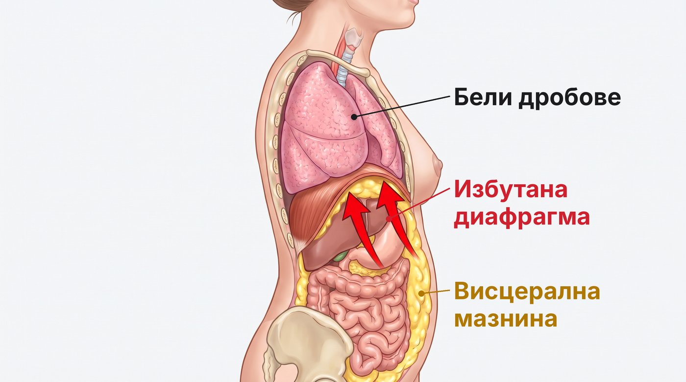

**Диафрагмата няма къде да слезе. Балонът не може да се напълни докрай.** И тялото ви компенсира по единствения начин, по който може — **с по-бързо, по-плитко дишане**.

Затова на третия етаж се чувствате, сякаш сте тичали маратон. **Не защото сте мързеливи. А защото дробовете ви работят в смален апартамент.**

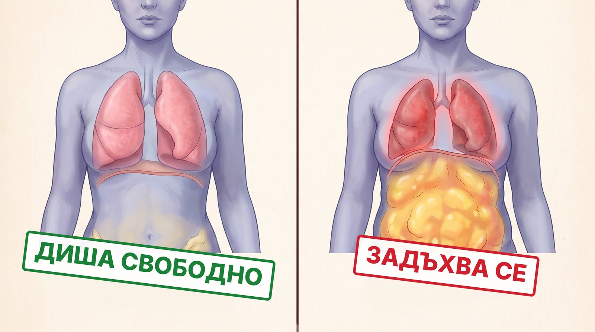

Знам. Това не е нещото, което ви казват рекламите. **Там всичко е „калории“ и „воля“.**

Но отговорете ми на това...

Защо познавате жени, които изглеждат слаби, но се задъхват по стълбите? И други, по-пълни, които стигат до петия етаж, говорейки по телефона?

Когато учени в Лондон сканирали с ядрено-магнитен резонанс хора с „нормално“ тегло, се оказало, че много от тях носят опасно много мазнина около органите. Дали им и име: **TOFI — „слаби отвън, дебели отвътре“**.

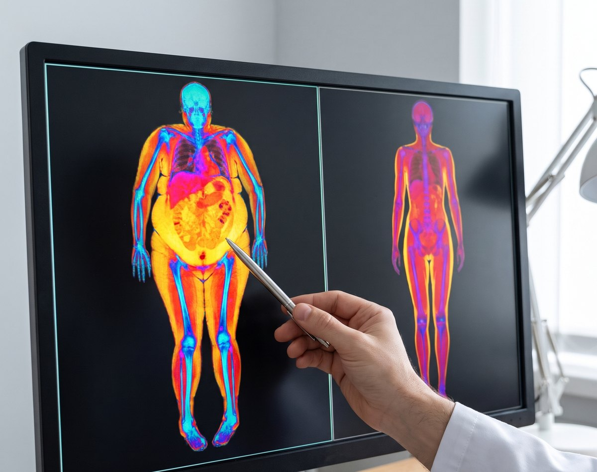

**Кантарът не я вижда. Огледалото не я вижда. Тя се вижда само на скенер.**

## ЗАЩО ТОВА Е НАЙ-ОПАСНАТА МАЗНИНА В ТЯЛОТО ВИ

И тук трябва да ви кажа нещо, което ме тревожи повече от стълбите.

Задъхването е само симптомът, който усещате. **Висцералната мазнина не е просто „излишно тегло“. Тя е жива, активна тъкан.** Денонощно отделя в кръвта вещества, които държат тялото в **тихо, хронично възпаление** — точно до сърцето, черния дроб и панкреаса.

И ето какво показват едни от най-големите проучвания, правени някога:

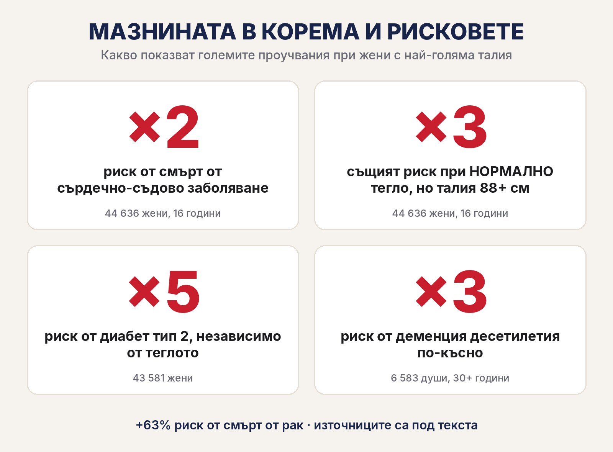

- **Сърцето — близо 2 пъти по-висок риск.** Учени проследяват 44 636 жени в продължение на 16 години. Жените с най-голяма талия са имали **близо 2 пъти по-висок риск да починат от сърдечно-съдово заболяване** от тези с най-тънка талия. [1]
- **Дори при „нормално“ тегло — 3 пъти.** При жените с нормално тегло, но с талия 88 см или повече, рискът от смърт от сърдечно-съдово заболяване е бил **3 пъти по-висок**. [1] Това е „слаба отвън, дебела отвътре“ — в цифри.
- **Диабет тип 2 — 5 пъти.** При 43 581 жени тези с талия около 92 см са имали **5 пъти по-висок риск от диабет тип 2** от тези с талия около 67 см — дори при еднакво тегло. [2]
- **Рак — с 63% по-висок риск от смърт.** В проучването с 44 636 жени най-голямата талия е свързана с **63% по-висок риск от смърт от рак**. [1] А Международната агенция за изследване на рака към СЗО свързва излишните мазнини с **поне 13 вида рак**. [3]
- **Паметта — почти 3 пъти.** Хората с най-голям корем на средна възраст са имали **почти 3 пъти по-висок риск от деменция** десетилетия по-късно (6 583 души, проследени над 30 години). [4]
- **Животът — с 78% по-висок риск от преждевременна смърт.** В най-голямото европейско проучване (359 387 души от 9 държави) жените с най-голяма талия са имали **78% по-висок риск от преждевременна смърт** — при еднакво тегло. [5]

**Прочетете го още веднъж: при еднакво тегло.** Не килограмите на кантара решават. Решава **къде** е мазнината.

> **Проверка за 10 секунди:** вземете сантиметъра и измерете талията си по средата между най-долното ребро и горния ръб на таза (горе-долу на нивото на пъпа), след нормално издишване.
>
> Според Световната здравна организация при жените **над 80 см рискът е повишен, а над 88 см — значително повишен**. [6]

Ако цифрата ви е стреснала — добре. Значи вече знаете повече от хората, които ви продават шейкове.

А добрата новина? Изследванията показват, че **висцералната мазнина реагира на промяната по-бързо от тази под кожата** — на движението и на по-малкото хапване. Но първо трябва да разберете защо изобщо се трупа.

Източници: 1. Zhang и съавт., [Circulation, 2008](https://pubmed.ncbi.nlm.nih.gov/18362231/) (Nurses' Health Study). 2. Carey и съавт., [American Journal of Epidemiology, 1997](https://pubmed.ncbi.nlm.nih.gov/9098178/). 3. Lauby-Secretan и съавт. (IARC), [NEJM, 2016](https://pubmed.ncbi.nlm.nih.gov/27557308/). 4. Whitmer и съавт., [Neurology, 2008](https://pubmed.ncbi.nlm.nih.gov/18367704/). 5. Pischon и съавт. (EPIC), [NEJM, 2008](https://pubmed.ncbi.nlm.nih.gov/19005195/). 6. СЗО, [Waist circumference and waist–hip ratio, 2008](https://www.who.int/publications/i/item/9789241501491). Проучванията показват връзка (асоциация), а не че мазнината е единствената причина.

## ЗАЩО ТЯ РАСТЕ, ДОРИ КОГАТО НАВИЦИТЕ ВИ СА ДОБРИ

Тук става интересно. И тук индустрията за отслабване предпочита да мълчи.

Мазнината около органите не се трупа само от това колко ядете. **Тя слуша и хормоните ви.**

**Първо — годините.** След 40, когато естрогенът започне да спада, **тялото на жената постепенно мести мазнината от бедрата и ханша към корема**. И не само под кожата — навътре, около органите. Затова толкова жени казват: **„Ям както преди, а коремът расте.“**

**Второ — стресът.** **Хормонът на стреса, кортизолът, е свързан с трупането на мазнина точно в корема.** Работа, сметки, деца, внуци, родители, безсънни нощи — **тялото живее в аларма и складира „за всеки случай“. Около органите.**

**Трето — превключвателят.** Във всяка ваша клетка има нещо като метаболитен превключвател. Учените го наричат AMPK. Когато е „включен“, клетката използва запасите си за енергия. **Когато е „изключен“, тялото предпочита да складира.**

И познайте какво го „приспива“ с годините?

Точно така. **Стресът, заседналият живот и всичко, което описах по-горе.**

Ето защо можете да имате прилични навици — салата на обяд, без хляб вечер, шише вода на бюрото — **и пак да се задъхвате**.

**Истинската причина изобщо не се крие в навиците ви. Тя е в мазнината, която огледалото не вижда — и в хормоните, които я трупат точно там.**

## ДОБАВКИТЕ, КОИТО ПИЕТЕ, МИНАВАТ ПРЕЗ ГРЕШНАТА ВРАТА

Сигурно си казвате: „Добре, но аз пия добавки. Пила съм и берберин. Защо нищо не се промени?“

Ето я малката мръсна тайна на капсулите.

Всичко, което глътнете, минава през стомаха. После през черния дроб. И чак тогава — каквото е останало — продължава нататък.

А с берберина на капсули има и още нещо. **При много хора той дразни стомаха: тежест, подуване, запек или разстройство.** Това е най-честата причина хората да го спрат — не защото не вярват в него, а защото стомахът им казва „стига“.

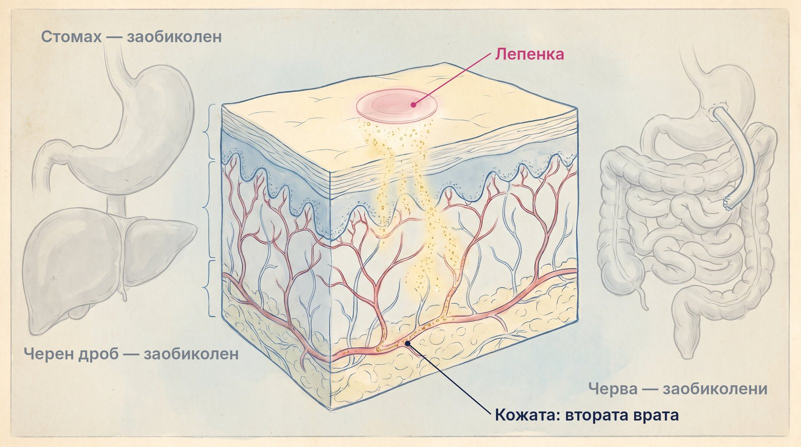

И така, в омагьосания кръг:

- Купувате нова добавка
- Стомахът се бунтува
- Спирате след две седмици
- Купувате следващата „чудодейна“ формула
- **Пак стълбите. Пак задъхването.**
- Повторение

**Някой печели от този кръг. И това не сте вие.**

## ВТОРАТА ВРАТА: ТРИТЕ НЕЩА, КОИТО ТРЯБВА ДА СЕ СЛУЧАТ ЕДНОВРЕМЕННО

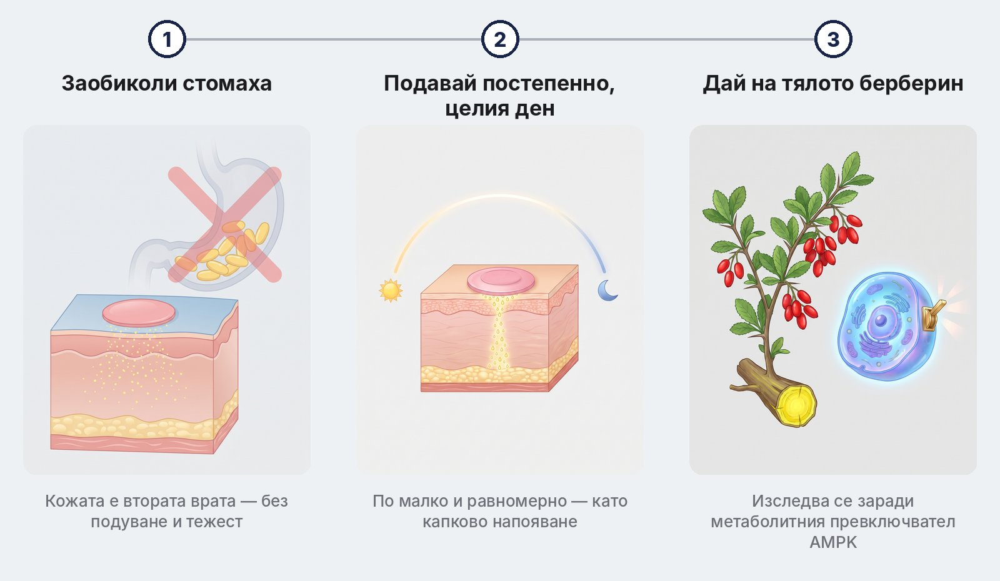

Ако искате да излезете от кръга, трябват ви три неща. Едновременно.

**Стъпка 1) ЗАОБИКОЛЕТЕ СТОМАХА.**

Ако стомахът е проблемът, не му давайте още капсули. Има втора врата — кожата. Тя не се подува, не се бунтува и не ви кара да търсите тоалетна в 7 сутринта.

**Стъпка 2) ПОДАВАЙТЕ ПОСТЕПЕННО, ЦЕЛИЯ ДЕН.**

Една капсула е като кофа вода, изсипана наведнъж върху градината. Повечето изтича. Това, което ви трябва, е капково напояване — по малко, равномерно, от сутрин до вечер.

**Стъпка 3) ДАЙТЕ НА ТЯЛОТО ТОВА, КОЕТО УЧЕНИТЕ ИЗСЛЕДВАТ.**

Берберинът — жълтото вещество от корена на растения като киселия трън — се изследва от години точно заради връзката му с метаболитния превключвател AMPK.

**Пропуснете дори една от трите стъпки и си губите времето.**

Ето защо капсулите разочароват. (Стомахът ги спира.)

Ето защо „детокс“ чаят разочарова. (Той само ви праща до тоалетната.)

Ето защо гладуването разочарова. (Тялото го приема като аларма и апетитът се връща двойно.)

Трябват ви и трите. Наведнъж. И точно това прави **FitPatches**.

## ТАЗИ МАЛКА РОЗОВА ЛЕПЕНКА ВБЕСЯВА ЦЯЛА ИНДУСТРИЯ

Помислете колко пари се въртят около вашето задъхване.

Шейкове. Чайове. Хапчета. Програми. Карти за фитнес, които ползвате три пъти. **Всички те имат един общ интерес — да опитвате пак. И пак. И пак.**

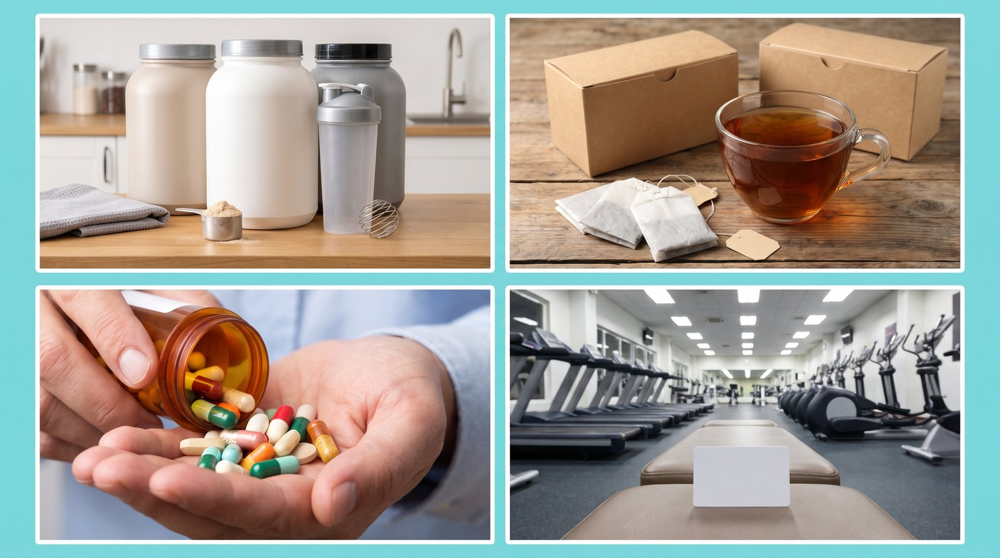

А какво предлага FitPatches? Една тънка лепенка на ден. Без меню. Без гладуване. Без шейк вместо вечеря. Без лъжица оцет на гладно.

Затова, когато пациентите ми чуят за FitPatches, първото, което казват, е: „Набутвация. Лепенки — да бе.“

Разбирам ги. И точно затова не искам да ми вярвате на думи. (Ще видите защо по-долу.)

## НАД 600 ДУШИ В БЪЛГАРИЯ ВЕЧЕ ИЗБРАХА ВТОРАТА ВРАТА

Докато индустрията ви продава поредния шейк, нещо друго се случва тихо.

**Над 600 души от цяла България вече поръчаха FitPatches.**

От София, Пловдив, Бургас и Варна... до Пазарджик, Хасково, Кюстендил, Враца и Айдемир.

Това са **над 1 500 пакета.** Или иначе казано — **над 45 000 лепенки.**

Няма да ви кажа колко килограма е свалил всеки от тях. Защото при всеки е различно и защото не обичам да лъжа.

Ще ви кажа друго: **над 600 души решиха да спрат с „от понеделник“.** И да опитат през кожата, вместо пак през стомаха.

## ТРИТЕ НЕЩА, КОИТО ЩЕ ЧУЕТЕ ЗА ЛЕПЕНКИТЕ (И ИСТИНАТА)

**„Лепенките са измама.“**

Затова FitPatches не искат нито стотинка предварително. Поръчвате, пратката идва, плащате на куриера, когато е в ръцете ви. Ако беше измама, щяха да искат парите ви преди това.

**„Ще ти пратят обикновени пластири.“**

Всяка лепенка FitPatches е розова, с размер на монета и с надпис „Fit Patches“ в кръг по ръба. Пълният състав е изписан на опаковката.

**„Действа само там, където е залепена.“**

Не. FitPatches не е крем за „топене“ на едно място. Лепенката е направена да подава съставките постепенно през целия ден — затова може на ръката, на корема или на бедрото, а мястото се сменя всеки ден.

## ЗАПОЗНАЙТЕ СЕ С FITPATCHES

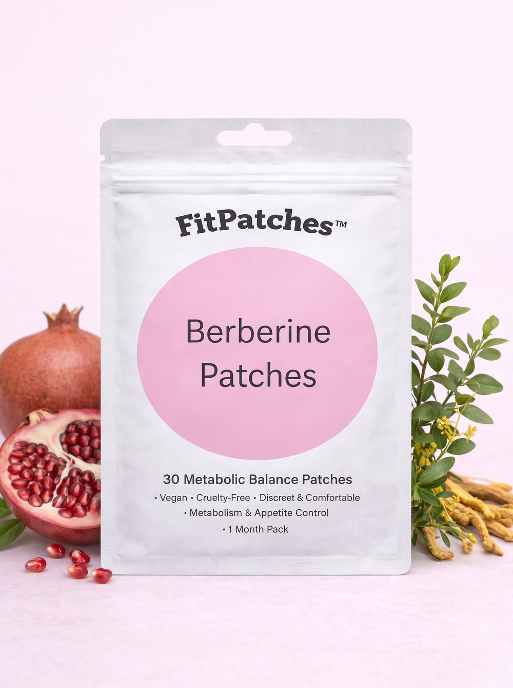

FitPatches е тънка розова лепенка с размер на монета. Залепвате я сутрин на чиста кожа — ръка, корем или бедро — и забравяте за нея до вечерта.

Тя прави и трите стъпки — през втората врата: кожата.

**Без капсули и без разбунтуван стомах.** Нищо не минава през храносмилането ви. Без подуване, без тежест, без вкус и мирис.

**Подава постепенно, през целия ден.** Активният слой е направен да отдава съставките бавно и равномерно — като капковото напояване, а не като кофата.

**Берберин плюс 5 помощника.** Не „една магическа съставка“, а формула, подбрана да работи заедно.

И е дискретна. Под ръкава никой не я вижда. Вие обаче я виждате всяка сутрин — и затова не я забравяте, както забравяте хапчетата.

## КАКВО ИМА В ЕДНА ЛЕПЕНКА — И КАКВО ПОКАЗВАТ ИЗСЛЕДВАНИЯТА

Не ви искам доверие на сляпо. Ето всяка съставка — и какво са установили учените за нея.

**1. Берберин — жълтото вещество от корена на киселия трън.**

Два мета-анализа обединяват рандомизирани контролирани проучвания — най-сериозният вид доказателство в медицината. В първия (12 проучвания) берберинът намалява **теглото средно с 2,07 кг, обиколката на талията с 1,08 см** и нивото на CRP — **маркера на хроничното възпаление**, същото възпаление, за което ви разказах по-горе. [7] Във втория (10 проучвания) обиколката на талията спада средно с **2,75 см** — и колкото по-дълго се приема, толкова по-голям е ефектът върху талията. [8]

**2. Канела.**

Мета-анализ на 12 рандомизирани проучвания с 786 души: **−1,02 кг тегло, −2,40 см обиколка на талията и −1,02% телесни мазнини**. Ефектът върху мазнините е бил най-ясен при прием 12 седмици и повече. [9]

**3. Хром.**

Мета-анализ на 11 рандомизирани проучвания показва **статистически значима загуба на тегло** спрямо плацебо. Ефектът е малък — затова хромът е помощник, а не главен герой. [10] Хромът допринася за нормалния метаболизъм на макроелементите.

**4. L-глутамин.**

В малко пилотно проучване жени с наднормено тегло приемат глутамин 4 седмици, **без да променят храненето си**. Талията им спада средно **от 102,7 на 98,9 см** — а при сравнителната добавка няма промяна. [11] Проучването е малко (6 жени), но е любопитно.

**5. Нар.**

Зърната му са сред най-богатите естествени източници на полифеноли (пуникалагини) — растителни вещества, които учените изследват заради връзката им с възпалението.

**6. Витамини от група B.**

Допринасят за нормалния енергиен метаболизъм и за **намаляване на умората и отпадналостта** — онова „като след маратон“ усещане.

Шест съставки. Всички са изписани на опаковката. Без скрити „патентовани смеси“. Без рецепта.

И тук идва парадоксът, който ме накара да се заинтересувам от лепенките.

## ЗАЩО ПРЕЗ КОЖАТА: ТРИТЕ БАРИЕРИ, КОИТО КАПСУЛАТА НЕ МОЖЕ ДА ПРЕСКОЧИ

Берберинът има един голям проблем. И той не е в самия берберин — а в пътя, по който го пращаме.

**Когато го глътнете като капсула, под 1% от него стига до кръвта.** [12] Под един процент. Останалото се губи по пътя. Ето къде:

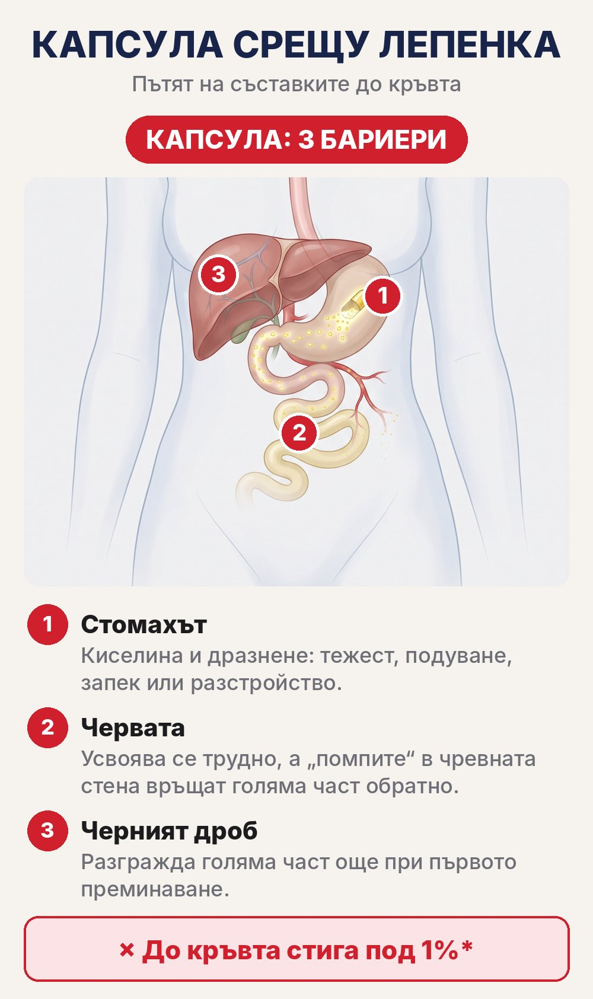

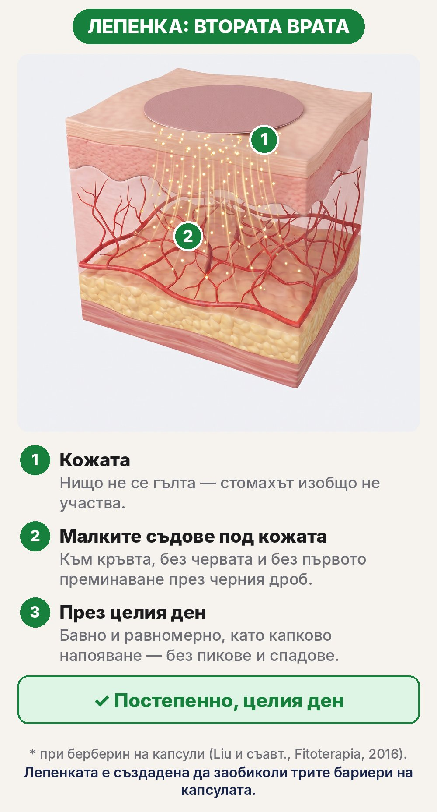

**Бариера 1: стомахът.** Капсулата се разтваря в киселина. При много хора берберинът дразни стомаха — тежест, подуване, запек или разстройство. Затова го спират.

**Бариера 2: червата.** Берберинът се усвоява трудно през чревната стена. А клетките на червата имат „помпи“ (P-гликопротеин), които **изпомпват голяма част от него обратно** — преди изобщо да е влязъл в тялото. [13]

**Бариера 3: черният дроб.** Каквото успее да мине, отива първо в черния дроб. Там голяма част се разгражда още при първото преминаване — преди да стигне до кръвта и до тъканите, където ви трябва. [13]

Три бариери. Една след друга. И накрая — под 1%.

**Лепенката е създадена да заобиколи и трите.**

**Без стомаха:** нищо не се гълта — няма киселина, няма подуване, няма тежест.

**Без червата и без първото преминаване през черния дроб:** съставките се подават през кожата към малките кръвоносни съдове под нея — по пътя, който не минава през храносмилането.

**Постепенно, през целия ден:** капсулата е „всичко наведнъж“ — пик и после спад. Лепенката подава бавно и равномерно, от сутрин до вечер, като капково напояване.

Принципът не е нов. **Медицината използва пластири през кожата от десетилетия** — никотинови, хормонални, против болка — точно защото този път заобикаля стомаха и черния дроб. FitPatches прилага същата логика за берберина и неговите пет помощника.

Източници: 7. Asbaghi и съавт., [Clinical Nutrition ESPEN, 2020](https://pubmed.ncbi.nlm.nih.gov/32690176/). 8. Xiong и съавт., [Complementary Therapies in Clinical Practice, 2020](https://pubmed.ncbi.nlm.nih.gov/32379652/). 9. Mousavi и съавт., [Clinical Nutrition, 2020](https://pubmed.ncbi.nlm.nih.gov/30799194/). 10. Onakpoya и съавт., [Obesity Reviews, 2013](https://pubmed.ncbi.nlm.nih.gov/23495911/). 11. Laviano и съавт., [European Journal of Clinical Nutrition, 2014](https://pubmed.ncbi.nlm.nih.gov/25226827/). 12. Liu и съавт., [Fitoterapia, 2016](https://pubmed.ncbi.nlm.nih.gov/26851175/). 13. Ai и съавт., [Drug Design, Development and Therapy, 2021](https://pmc.ncbi.nlm.nih.gov/articles/PMC8964367/).

## КАК СЕ ИЗПОЛЗВА — ТРИ ДВИЖЕНИЯ СУТРИН

1. Залепете върху чиста, суха кожа — ръка, корем или бедро
2. Носете я през деня — под дрехите никой не я вижда
3. На следващата сутрин я сменете с нова, на ново място

Една опаковка съдържа 30 лепенки — точно един месец. **Постоянството е ключът:** дайте на тялото поне 4–8 седмици.

## ЕТО КАК ИЗГЛЕЖДА ВАШИЯТ ДЕН С FITPATCHES

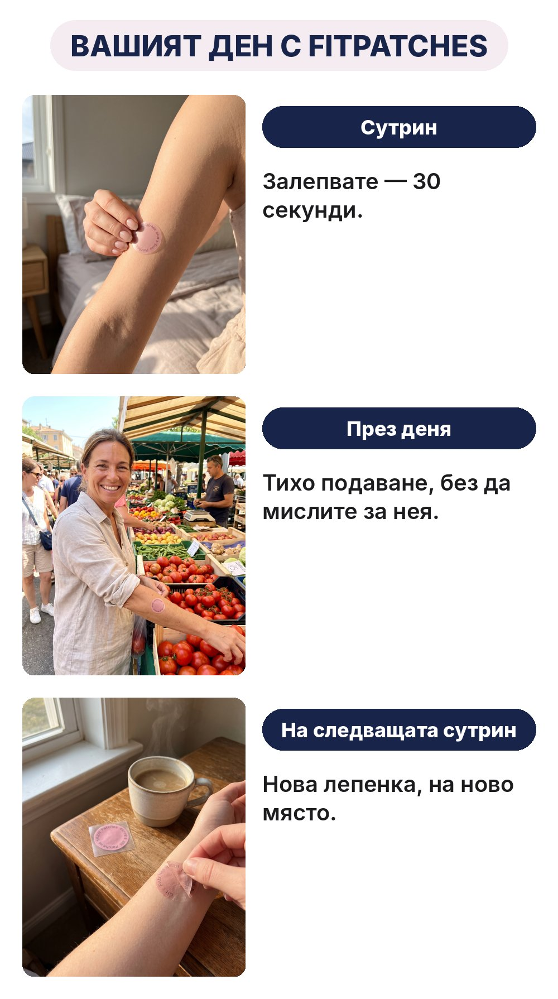

**Сутрин, 30 секунди: залепвате.** Върху чиста, суха кожа. Една лепенка — толкова.

**През деня: тихото подаване.** Докато сте на работа, на пазар или с внуците, лепенката подава съставките постепенно. Без пикове и без спадове. Без да мислите за нея.

**На следващата сутрин: нова.** Сменяте мястото всеки ден, за да си почива кожата.

Какво казват клиентите, че усещат най-напред? Не стълбите. Нещо по-тихо — *по-спокоен апетит* и по-малко желание за сладко през деня.

> **И една честна бележка, която другите няма да ви кажат:**
>
> FitPatches не „топи“ мазнина и не е лекарство. Тя е помощник. Най-добре работи, когато ѝ помогнете и вие — малко повече ходене, малко по-малко захар, повече сън. Дайте ѝ поне 4–8 седмици. Резултатите са индивидуални.

## ЛЕПЕНКА СРЕЩУ КАПСУЛИ И ШЕЙКОВЕ

|  | FitPatches | Капсули и шейкове |
| --- | --- | --- |
| Формат | Лепенка на кожата | Гълтане или пиене |
| Минава през стомаха | Не | Да |
| Подуване и тежест | Не | Често |
| Подава през целия ден | Да | Не, наведнъж |
| Пъти на ден | 1 | 2–3 |
| Вкус и мирис | Няма | Често |

## КАКВО ДА ОЧАКВАТЕ — СЕДМИЦА ПО СЕДМИЦА

**Първите дни.** Свиквате с лепенката — сутрин я залепвате и забравяте за нея. Някои усещат по-малко желание за сладко още тогава, други не. И двете са нормални.

**Седмица 1–2.** Берберинът се подава постепенно всеки ден. Тук много клиенти казват, че вечер посягат по-рядко към сладкото и хапват по-спокойно.

**Седмица 3–4.** Вече е навик, като миенето на зъбите. Добавете по 10 минути ходене на ден. И вземайте стълбите — бавно, един етаж повече всяка седмица, без да се срамувате, ако спрете.

**Седмица 4–8.** Тук много жени започват да виждат промяна — в колана, в дрехите, в стълбите. При всеки е различно. Затова един пакет е точно за един месец, а пакетите 2+1 и 3+2 излизат най-изгодно.

Не чакайте чудо за една нощ. Чакайте малки промени, които се трупат — точно както се е трупала и мазнината.

## КОЛКО ВИ СТРУВА „ИНДУСТРИЯТА ЗА ОТСЛАБВАНЕ“

Нека сметнем колко струва една година „правене на всичко както трябва“ (приблизително):

- Карта за фитнес: 30–60 € на месец, тоест 360–720 € на година (дори да ходите три пъти)
- Шейкове и заместители на храна: 30–50 € на месец
- „Детокс“ чайове и хапчета от рекламите: 20–40 € на месец
- Консултации и хранителни режими: 30–60 € на консултация

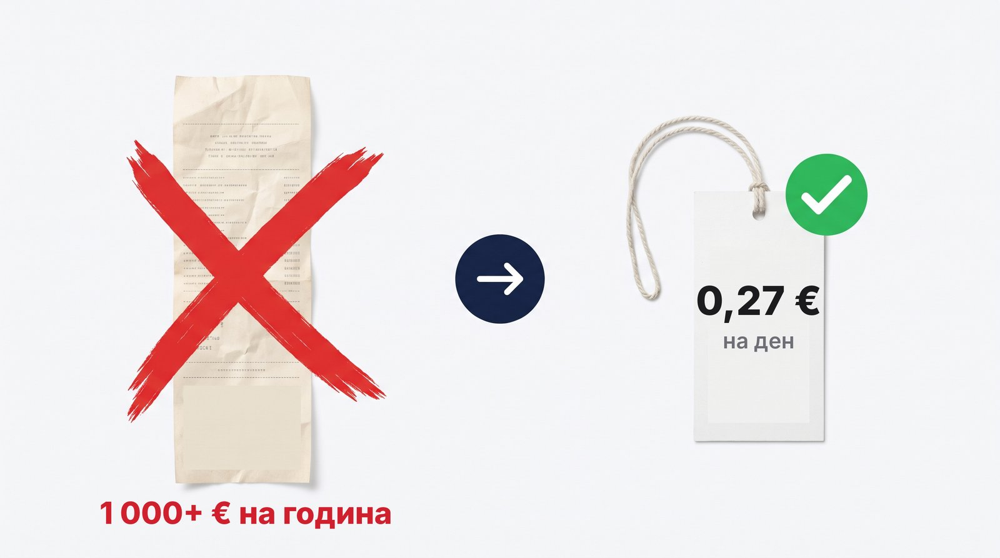

**Лесно над 1 000 € на година.** **За да стоите пак на площадката между втория и третия етаж.**

Индустрията обожава този модел. Знаете ли защо? **Защото се връщате. Всеки януари. Всеки понеделник.**

Това е златна мина, изградена върху вашето „от понеделник“.

## ЦЕНАТА „СТИГА ВЕЧЕ“: 14,99 €

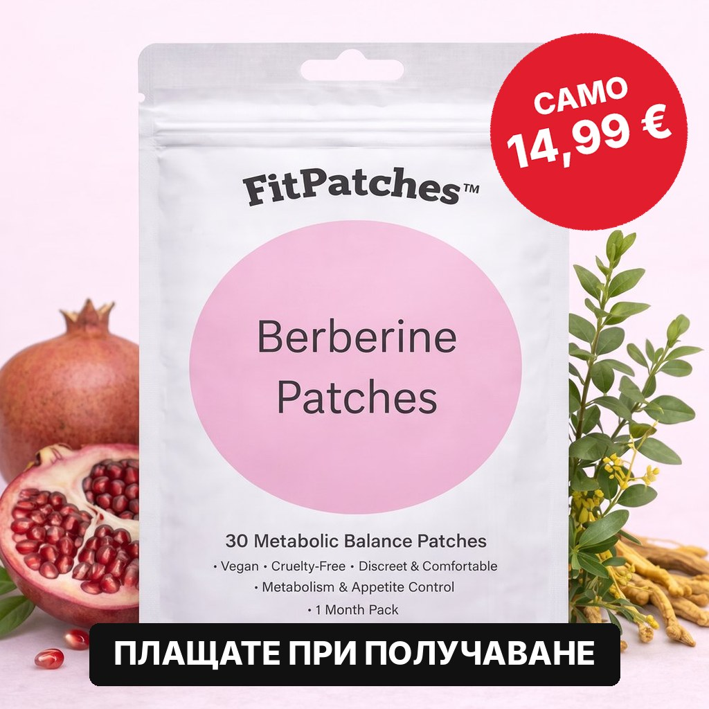

> Редовната цена на един пакет FitPatches е ~~29,99 €~~. В момента е **14,99 €** — 30 лепенки, точно за един месец. Това е **0,50 € на ден**.
>
> Ако вземете **2 пакета, третият е подарък**: 27,99 € за три месеца — **0,31 € на ден**.
>
> А при **3 + 2 подарък** плащате 39,99 € за пет месеца. Това са **0,27 € на ден** — по-малко от едно кафе от машината.

Плащане с **наложен платеж** — плащате на куриера, когато пратката е в ръцете ви. Нищо предварително. Без абонамент и без автоматични плащания. Изпраща се с Еконт до адрес или офис, обикновено за 2–4 работни дни.

По-малко от един месец карта за фитнес. По-малко от едно шише „фет бърнър“. По-малко от онзи шейкър, който събира прах в шкафа.

**[ВИЖТЕ ЦЕНИТЕ НА FITPATCHES >>>](https://fitpatches.net/products/fitpatches-berberinovi-plastiri-30?utm_source=facebook&utm_medium=advertorial&utm_campaign=adv26-zadahvane)**

## НО ЕТО Я УЛОВКАТА: ПРАЗНИЦИТЕ ИДВАТ

От Никулден до Йордановден са 32 дни трапези. Шаран. Сарми. Баница. Козунак. Тава след тава.

Повечето хора ще си кажат: **„Ще започна след празниците.“** **И ще посрещнат януари на същата площадка** — само с още малко мазнина там, където огледалото не стига.

Ако поръчате днес, до празниците ще имате няколко седмици навик. Ще влезете в декември не с „от понеделник“, а вече започнали.

И ето какво ме човърка...

**Всяка седмица, в която отлагате, е още една седмица, в която:**

- Спирате на площадката „да си оправите торбите“
- Купувате поредната добавка, която стомахът ви ще върне
- Мазнината около органите си остава там, където никой не я вижда
- Казвате си „от понеделник“

Докато първата стъпка струва по-малко от кафе на ден.

> ⚠️ ЦЕНАТА ОТ 14,99 € Е ПРОМОЦИОНАЛНА — РЕДОВНАТА Е 29,99 € ⚠️

## КАК ДА РАЗПОЗНАЕТЕ ОРИГИНАЛА

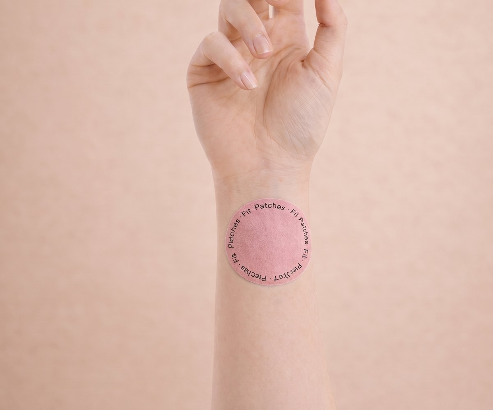

Оригиналните FitPatches са розови, с размер на монета, с надпис „Fit Patches“ в кръг по ръба. Пликът е бял, с розов кръг „Berberine Patches“ и надпис „30 Metabolic Balance Patches“.

Поръчвайте само от официалния сайт **fitpatches.net**. Ако имате въпрос преди поръчка, обадете се на екипа на FitPatches: [0887 459 494](tel:0887459494).

## ЗАЩО НЕ ВИ МОЛЯ ДА МИ ВЯРВАТЕ

Вижте, разбирам ви.

**Лъгани сте преди. Плащали сте предварително за „чудо“, което се оказа скъп боклук.** Слушали сте обещания за „минус 10 кила за месец“.

Аз няма да ви обещавам килограми. А FitPatches няма да ви поискат пари предварително.

Поръчвате. Пратката пристига. **Плащате на куриера, когато е в ръцете ви.**

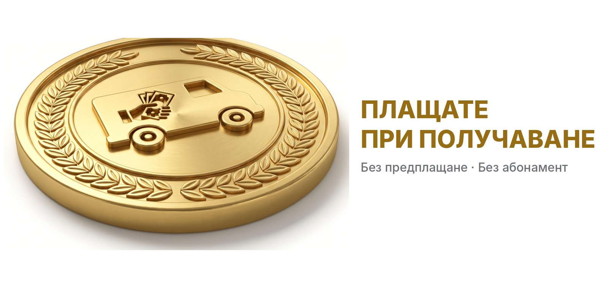

Пробвайте един пакет. Ако след месец не усетите разлика — просто не поръчвате пак. Няма абонамент, който да забравите да спрете.

Толкова е просто.

## ВЪПРОСИТЕ, КОИТО ВСИЧКИ ЗАДАВАТ

**Наистина ли ще усетя разлика?**

При всеки е различно. Много клиенти казват, че първо усещат по-спокоен апетит, още в първите дни. За видима промяна дайте на тялото 4–8 седмици, по една лепенка на ден.

**Лепенката „топи“ ли мазнината?**

Не. FitPatches не е лекарство и не „топи“ мазнина. Тя е помощник за апетита и метаболизма, който работи най-добре заедно с малко повече движение и сън.

**Ще ми разстрои ли стомаха?**

Не. Нищо не минава през храносмилането ви. Точно това е смисълът на втората врата.

**Къде да я залепя?**

На чиста и суха кожа — ръка, корем или бедро. Сменяйте мястото всеки ден. Ако кожата се зачерви или засърби, махнете лепенката и сменете мястото.

**Ако забравя един ден?**

Нищо страшно — продължавате на следващия ден. Не слагайте две наведнъж, за да наваксате.

**Мога ли, ако пия лекарства?**

Берберинът може да влияе на действието на някои лекарства — например за кръвна захар или кръвно налягане. Ако пиете лекарства всеки ден, първо попитайте лекаря си. Не използвайте FitPatches при бременност и кърмене без консултация с лекар.

**Задъхвам се много. Само мазнината ли е?**

Не непременно. Ако задъхването е ново, внезапно, засилва се или идва с болка в гърдите, сърцебиене или отоци на краката — идете на лекар. Може да е сърцето или белите дробове, а за това никоя лепенка не е решение.

**Как плащам и кога пристига?**

С наложен платеж — плащате на куриера. Изпраща се с Еконт до адрес или офис, обикновено за 2–4 работни дни.

**Има ли абонамент?**

Няма. Плащате веднъж за това, което поръчате. Без автоматични плащания.

## ИЗБОРЪТ, КОЙТО ВИ ЧАКА НА ВСЕКИ ЕТАЖ

Вижте, знам как обикновено става.

Някои хора ще прочетат цялата тази страница и пак няма да направят нищо. Ще си кажат, че ще „помислят“. Ще я забравят до довечера.

**И след шест месеца ще стоят на същата площадка.**

Не искам това да сте вие.

Защото точно сега сте на кръстопът.

**Път #1: Продължавайте както досега.**

Купувайте поредната добавка, която стомахът ви ще върне. Пийте шейка вместо вечеря. Започвайте всеки понеделник. Спирайте на площадката „да си оправите торбите“. И оставете мазнината около органите да си върши работата, там, където никой не я вижда.

**Път #2: Опитайте втората врата.**

**Над 600 души вече минаха през нея.** Заобиколете стомаха. Подавайте постепенно, всеки ден. Дайте на тялото си берберина, който учените изследват от години — с една лепенка сутрин и малко повече движение.

И си представете картината, към която вървите: внучката тича пред вас нагоре по стълбите, вие ѝ казвате „чакай ме горе“ — не защото нямате въздух, а защото искате тя да победи.

За мен изборът изглежда доста очевиден.

А нямате и какво да губите. Плащате при получаване.

## ЕТО ТОЧНО КАКВО ДА НАПРАВИТЕ СЛЕД ТОВА

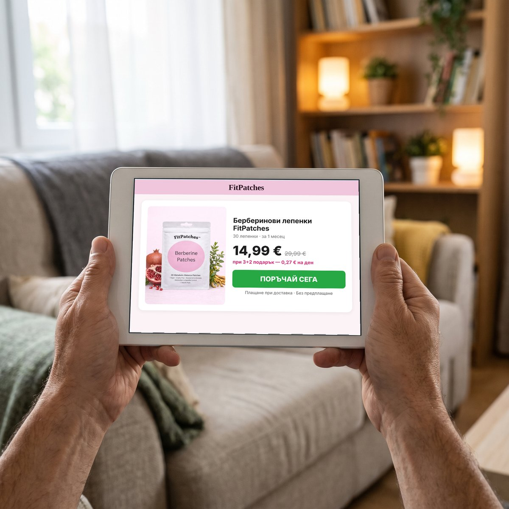

1. Кликнете върху зеления бутон по-долу
2. Изберете пакет (при 3 + 2 подарък излиза 0,27 € на ден — вземете и за близък човек)
3. Попълнете име, телефон и адрес — ще ви се обадят за потвърждение
4. Платете на куриера, когато пратката е в ръцете ви
5. Още на следващата сутрин залепете първата лепенка
6. И тази седмица изкачете стълбите бавно — без да се срамувате, ако спрете

Но каквото и да правите...

Не затваряйте тази страница с мисълта „ще се върна по-късно“.

**„По-късно“ е още една площадка. Още един понеделник. Още едни празници, след които „ще започнете“.**

**Тялото ви е чакало достатъчно.**

**[ВЗЕМЕТЕ FITPATCHES СЕГА (ОТ 14,99 €) >>>](https://fitpatches.net/products/fitpatches-berberinovi-plastiri-30?utm_source=facebook&utm_medium=advertorial&utm_campaign=adv26-zadahvane)**

ПЛАЩАТЕ ПРИ ПОЛУЧАВАНЕ · БЕЗ ПРЕДПЛАЩАНЕ · БЕЗ АБОНАМЕНТ

ПРИСЪЕДИНЕТЕ СЕ КЪМ НАД 600 ДУШИ ОТ ЦЯЛА БЪЛГАРИЯ

ПОРЪЧКИ САМО ПРЕЗ ОФИЦИАЛНИЯ САЙТ FITPATCHES.NET

С уважение,

Д-р Георги Марков

**P.S.** Следващия път, когато спрете на площадката, спомнете си балона в кутията. Не е мързел. Не е само възрастта. Това е мазнина — там, където огледалото не стига. И с нея може да се работи.

**P.P.S.** Никой не ви иска нищо предварително. Плащате на куриера, когато пратката е в ръцете ви. Единственото, което рискувате, е още една зима на стълбите.

**P.P.P.S.** До Никулден остава по-малко време, отколкото мислите. Поръчайте днес и влезте в празниците вече започнали — а не „от понеделник“, на същата площадка.

**[ПОРЪЧАЙТЕ FITPATCHES — ПЛАЩАТЕ ПРИ ПОЛУЧАВАНЕ >>>](https://fitpatches.net/products/fitpatches-berberinovi-plastiri-30?utm_source=facebook&utm_medium=advertorial&utm_campaign=adv26-zadahvane)**

---

ТОВА Е РЕКЛАМА И НЕ Е НОВИНАРСКА СТАТИЯ. Материалът е подготвен за FitPatches с участието на д-р Георги Марков.

FitPatches не е лекарствен продукт и не е предназначен за диагностика, лечение или предотвратяване на заболявания. Не замества разнообразното и балансирано хранене, здравословния начин на живот и медицинската консултация. Резултатите са индивидуални. Снимките на скенери и илюстрациите са с илюстративна цел. Цитираните проучвания описват връзката между мазнината в корема и рисковете за здравето; те не са правени с FitPatches и не означават, че продуктът намалява тези рискове. Проучванията за съставките са с прием през устата и не са правени с FitPatches. Задъхването може да е симптом на сърдечно или белодробно заболяване — ако е ново, внезапно или се засилва, потърсете лекар. При бременност, кърмене или прием на лекарства се консултирайте с лекар преди употреба.

[0887 459 494](tel:0887459494) | [Контакти](https://fitpatches.net/pages/contact) | [Политика за поверителност](https://fitpatches.net/policies/privacy-policy) | [За FitPatches](https://fitpatches.net/pages/koi-sme-nie)
